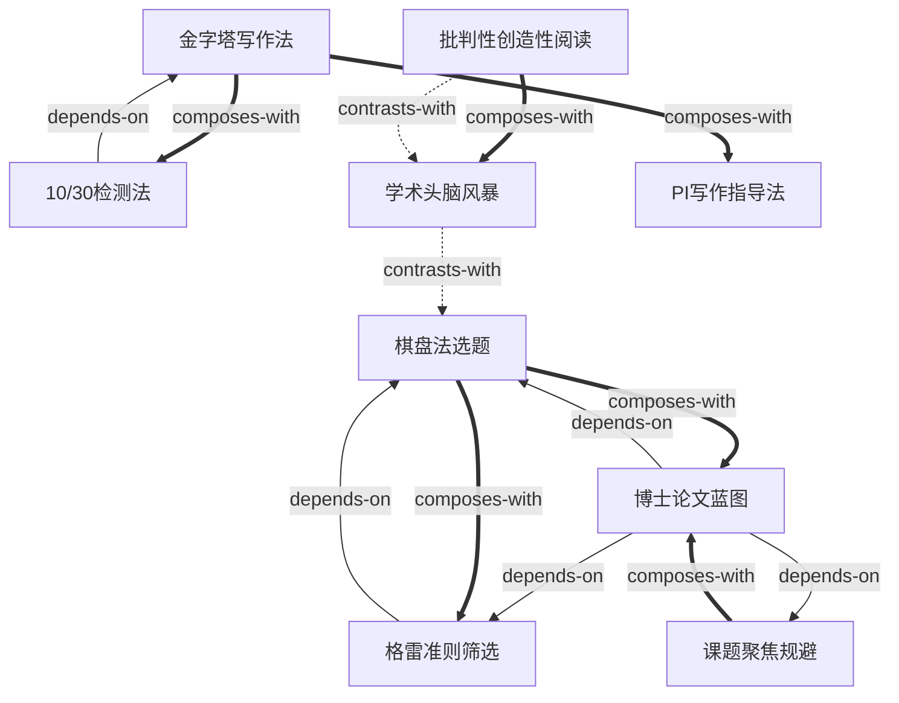

# 《学术研究：你的成功之道》 — Skill Index

> 本书由 book2skill 蒸馏, 共产出 **9** 个 skills。
> 处理时间: 2026-07-06

## 关于这本书

- **作者**: 凌晓峰 (Charles X. Ling), 杨强 (Qiang Yang)
- **出版年**: 2012
- **一句话主旨**: 学术研究的成功之道在于以创新性和影响力为核心，用棋盘法找课题、格雷准则筛选、金字塔写作法产出论文，成为领域风向标和独立研究者。
- **整书理解**: 见 [BOOK_OVERVIEW.md](./BOOK_OVERVIEW.md)

---

## Skill 列表 (按主题分组)

### 选题与研究方向

- [`matrix-method-topic-selection`](./matrix-method-topic-selection/SKILL.md) — 棋盘法：以问题×方法矩阵视觉化定位研究空白，找到创新突破口
- [`grays-criteria-problem-evaluation`](./grays-criteria-problem-evaluation/SKILL.md) — 格雷准则：用五条标准系统性评估研究问题是否值得投入
- [`research-focus-anti-guerrilla`](./research-focus-anti-guerrilla/SKILL.md) — 课题聚焦：识别和规避"课题游击战""学术三脚猫""抄近路"三类聚焦失败模式

### 产生想法

- [`critical-creative-paper-reading`](./critical-creative-paper-reading/SKILL.md) — 批判性创造性阅读：30%读、70%想的论文阅读法，从阅读中挖掘研究灵感
- [`academic-brainstorming-ideation`](./academic-brainstorming-ideation/SKILL.md) — 学术头脑风暴：延迟揭示作者答案的多人互动产生想法方法

### 论文写作

- [`top-down-pyramid-writing`](./top-down-pyramid-writing/SKILL.md) — 自上而下金字塔写作：逻辑论证五大步骤+层级细化的论文写作骨架
- [`ten-thirty-readability-test`](./ten-thirty-readability-test/SKILL.md) — 10/30检测：投稿前的论文可读性量化检验方法

### 博士规划与指导

- [`thesis-blueprint-planning`](./thesis-blueprint-planning/SKILL.md) — 博士论文蓝图：二年级结束时制定目录级规划，允许50-80%灵活调整
- [`progressive-improvement-writing-coaching`](./progressive-improvement-writing-coaching/SKILL.md) — PI循序渐进式写作指导：导师逐页精讲+学生逐页进步的写作教学法

---

## 引用图



图例:
- `-->` depends-on (先学A才能用B)
- `==>` composes-with (配合使用效果更好)
- `-.->` contrasts-with (两种可选方法)

---

## 推荐学习顺序

### 第一层：基础工具 (无前置依赖)
1. **`critical-creative-paper-reading`** (v03) — 输入技能，每天读论文都会用到
2. **`research-focus-anti-guerrilla`** (v08) — 诊断技能，确保自己不跑偏

### 第二层：选题工具 (依赖基础工具)
3. **`matrix-method-topic-selection`** (v01) — 用棋盘法找到研究空白
4. **`grays-criteria-problem-evaluation`** (v02) — 用格雷准则筛选候选课题 (依赖v01)
5. **`academic-brainstorming-ideation`** (v06) — 与v03配合使用，产生新想法

### 第三层：规划与输出
6. **`thesis-blueprint-planning`** (v07) — 用前面积累的课题和方法制定毕业论文蓝图 (依赖v01+v02+v08)
7. **`top-down-pyramid-writing`** (v04) — 学习论文写作结构
8. **`ten-thirty-readability-test`** (v05) — 用10/30检测检验论文质量 (依赖v04)

### 第四层：导师专用
9. **`progressive-improvement-writing-coaching`** (v09) — 导师指导学生写作 (配合v04使用)

---

## 接入 darwin-skill

所有 skill 均带有 `test-prompts.json`, 可直接接入自动进化:

```
darwin evolve books/academic-research-success/
```

---

## 审计轨迹

- 候选单元池: [candidates/](./candidates/)
- 被淘汰的候选 (含原因): [rejected/](./rejected/)
- BOOK_OVERVIEW: [BOOK_OVERVIEW.md](./BOOK_OVERVIEW.md)
- 验证记录: [verified.md](./verified.md)
