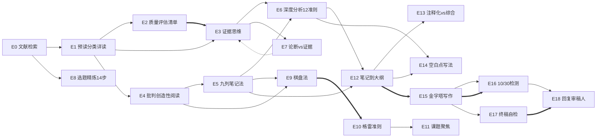

# 论文写作Skills 系列 · 体系总览 (SUITE_INDEX)

> 状态: **v2.0 — 10期压缩方案已确认**（2026-09-29 Rod 拍板）
> 演进: v0.9 草案（19期产线，2026-08-13）→ v2.0 压缩为10支正片（第6期上下集）
> 决策依据: [系列规划-10期压缩方案-20260929.md](./系列规划-10期压缩方案-20260929.md)
> ⚠️ 本文件为本地快照，正式生效需回传 Coze 云盘项目

---

## 1. 系列定位

| 项 | 约定 |
|---|---|
| 系列名 | **论文写作Skills**（沿用第 0 期已发布物料） |
| 内容形式 | 抖音视频演示"给 AI 装一个 skill，一句话搞定一个科研环节"，skill 打包评论区自取 |
| 受众 | 研究生、科研新手、想用 AI 提效学术工作的人 |
| 源头 | 两本书蒸馏：《文献综述写作》+ 《学术研究：你的成功之道》（蒸馏归档 books/ 不动） |
| 期号 | **主线第1~9期共9个期号，第6期为上下集，合计10支正片；第0期/B0/B1/B2 为番外位** |

---

## 2. 工位流水线 → 期号映射（v2.0）

```
检索(第0期) → 筛选(第1-2期) → 精读(第3-5期) → 方向发现(第6期上/下) → 综述撰写(第7期) → 正文撰写(第8期) → 投稿返修(第9期)
```

七个工位全保留；工位到期号从"一期一skill"改为"一期一工位、多skill合并"（第2/4/6/7/8/9期均为合并期）。

---

## 3. 期数总表（v2.0 主线 10 支正片）

| 期 | 工位 | 合并的 skill | 定位一句话 | 状态 |
|---|---|---|---|---|
| 第0期 | 检索 | `literature-search` | AI一条命令搜遍全网论文 | ✅ 已发布 |
| 第1期 | 筛选 | `preread-classify-deepread` | AI批量筛论文，只有10%值得精读 | ✅ 已产出 |
| 第2期 | 筛选 | `research-quality-checklist` + `evidence-thinking` | AI给50篇论文打分：强中弱 | ✅ 已产出 |
| 第3期 | 精读 | `critical-creative-paper-reading` | 30%读70%想，AI榨干一篇论文 | ✅ 已产出 |
| 第4期 | 精读 | `spreadsheet-note-system` + `deep-article-analysis` | 20篇论文一张表收编 | ✅ 已产出 |
| 第5期 | 精读 | `claim-vs-evidence` | 作者说的≠研究发现 | ✅ 已产出 |
| 第6期·上 | 方向 | `matrix-method-topic-selection` | 棋盘法出候选 | ✅ 已产出（物料标"第9期"，**发布前改号**） |
| 第6期·下 | 方向 | `grays-criteria-problem-evaluation` | 格雷准则筛最优 | ✅ 已产出（物料标"第10期"，**发布前改号+结尾改口**） |
| 第7期 | 综述 | `notes-to-outline-synthesis` + `blank-spots-and-future-directions` + `annotative-vs-synthetic-writing` | AI帮你缝综述 | ⬜ 新做 |
| 第8期 | 正文 | `top-down-pyramid-writing` + `ten-thirty-readability-test` | AI帮你写论文 | ⬜ 新做 |
| 第9期 | 投稿 | `final-self-edit-checklist` + `response-to-reviewers` | AI帮你投稿 | ⬜ 新做 |

**进包不进片**：`topic-refinement`（十四步）、`research-focus-anti-guerrilla`（反游击）随第6期skill包附赠；数据好再捞出来做番外。
**番外**：B0 `zotero-cite`（✅ 已发布）、B1 `academic-brainstorming-ideation`、B2 `thesis-blueprint-planning`（视数据加更）。
**不进系列**：`progressive-improvement-writing-coaching`（受众是导师，留 books/ 归档）。

22 个 skill 全覆盖，无遗漏。

---

## 4. 合并映射（历史记录，Phase 2 已执行）

| 原 skill（books/ 归档） | 新 skill | 合并逻辑 |
|---|---|---|
| `quantitative-quality-checklist` + `qualitative-quality-checklist` | `research-quality-checklist` | 定量13条/定性8条对照清单 |
| `all-research-is-flawed` + `juror-evidence-evaluation` | `evidence-thinking` | 认知前提 + 评估流程 |
| `reader-is-always-right` + `final-self-edit-checklist` | `final-self-edit-checklist` | 心态原则 + 100项清单 |

v2.0 新增合并（视频层面，skill 本体不合并）：02+03 同期、05+06 同期、12+14+13 同期、15+16 同期、17+18 同期。

---

## 5. 统一依赖图（skill 间依赖不变，v2.0 沿用）

图例：`-->` depends-on；`==>` composes-with；`-.->` contrasts-with



### 依赖关系文字版（写入各 skill 的"相关 skills"段）

| skill | depends-on | composes-with | contrasts-with |
|---|---|---|---|
| E1 预读分类 | E0 | — | — |
| E2 质量清单 | E1 | E3 | — |
| E3 证据思维 | E1 | E2 | E7 |
| E4 批判创造性阅读 | E1 | E9, E5 | — |
| E5 九列笔记 | E4 | E12 | — |
| E6 深度分析 | E5, E3 | E7, E12 | — |
| E7 论断vs证据 | E3 | E6 | E3 |
| E8 选题精炼 | E0 | E9 | — |
| E9 棋盘法 | E4, E5 | E10, E8 | — |
| E10 格雷准则 | E9 | E11 | — |
| E11 课题聚焦 | — | E10 | — |
| E12 笔记到大纲 | E5, E6 | E15 | — |
| E13 注释化vs综合 | E12 | — | — |
| E14 空白点写法 | E6, E12 | — | — |
| E15 金字塔写作 | — | E12, E16 | — |
| E16 10/30检测 | E15 | E15 | — |
| E17 终稿自检 | E15 | E18 | — |
| E18 回复审稿人 | E16 | E17 | — |

注：E7 与 E3 为"两种可选方案"——整体权衡用陪审员模型（E3），逐句拆解用论断vs证据（E7）。

---

## 6. 每期串场指针表（v2.0）

| 期 | 结尾串场 | 状态 |
|---|---|---|
| 第0期 | "这是底座。下期用这个底座，教你让 AI 批量筛论文" | ✅ 已兑现 |
| 第1期 | "筛出一堆，哪篇值得信？下期给你 13+8 条质量清单" | ✅ 已兑现 |
| 第2期 | "筛完评完，哪篇值得精读？下期：30%读、70%想" | ✅ 已产出（证据思维已并入本期内容） |
| 第3期 | "读出来的想法别丢，下期九列笔记法" | ✅ 已兑现 |
| 第4期 | "还剩最后一个坑——下期论断vs证据，一条准则讲透" | ✅ 已兑现 |
| 第5期 | ⚠️ 现稿结尾为"想法变课题，下期拆" → **发布前改口**："论文读透了，课题在哪？下期棋盘法，给你一张创新地图" | 待改口 |
| 第6期·上 | "空格子不等于好课题。下期格雷准则：5条标准筛出真黄金" | ✅ 原生成立 |
| 第6期·下 | ⚠️ 现稿结尾为"下期教你聚焦" → **发布前改口**："课题有了，几十篇文献的料怎么缝成一张综述大纲？下期教你" | 待改口 |
| 第7期 | "综述骨架有了，正文怎么写？下期：金字塔五步骨架" | 新做 |
| 第8期 | "写完了先别投。下期：终稿自检+回复审稿人，投稿冲刺" | 新做 |
| 第9期 | "整条产线到此闭环。评论区打包全部 skill，一句话装进你的 AI" | 新做 |

---

## 7. 目录结构约定（沿用）

- 仓库 `skills/` 按 skill 编号目录（00~18、B0~B2）；`episodes/` 按期数目录放视频物料
- skill id 全部小写连字符；显示名中文
- 每期发布时从 `skills/<编号>/` 打包 skill 供粉丝下载
- `books/`、`distillation/` 不动（蒸馏审计档案）

---

## 8. 溯源表（skill → 书 → 章节）

| skill | 书 | 章节 |
|---|---|---|
| E0 literature-search | 自研 | — |
| E1 preread-classify-deepread | 文献综述 | 第2-4章 |
| E2 research-quality-checklist | 文献综述 | 第6-7章（定量13条+定性8条） |
| E3 evidence-thinking | 文献综述 | 第1章陪审员模型+第6章准则十三 |
| E4 critical-creative-paper-reading | 成功之道 | 第3章 3.3-3.4 |
| E5 spreadsheet-note-system | 文献综述 | 第4章4.5+第8章 |
| E6 deep-article-analysis | 文献综述 | 第5章（准则一到十二） |
| E7 claim-vs-evidence | 文献综述 | 第5章5.7 准则七 |
| E8 topic-refinement | 文献综述 | 第3章 |
| E9 matrix-method-topic-selection | 成功之道 | 第4章 4.3/4.5 |
| E10 grays-criteria-problem-evaluation | 成功之道 | 第4章 |
| E11 research-focus-anti-guerrilla | 成功之道 | 第2章 |
| E12 notes-to-outline-synthesis | 文献综述 | 第9章 |
| E13 annotative-vs-synthetic-writing | 文献综述 | 第11章 |
| E14 blank-spots-and-future-directions | 文献综述 | 第10章 |
| E15 top-down-pyramid-writing | 成功之道 | 第5章 |
| E16 ten-thirty-readability-test | 成功之道 | 第5章 |
| E17 final-self-edit-checklist | 文献综述 | 第12章+附录A |
| E18 response-to-reviewers | 成功之道 + 通用惯例 | 第5章5.8+第6章6.7 |
| B1 academic-brainstorming-ideation | 成功之道 | — |
| B2 thesis-blueprint-planning | 成功之道 | — |
