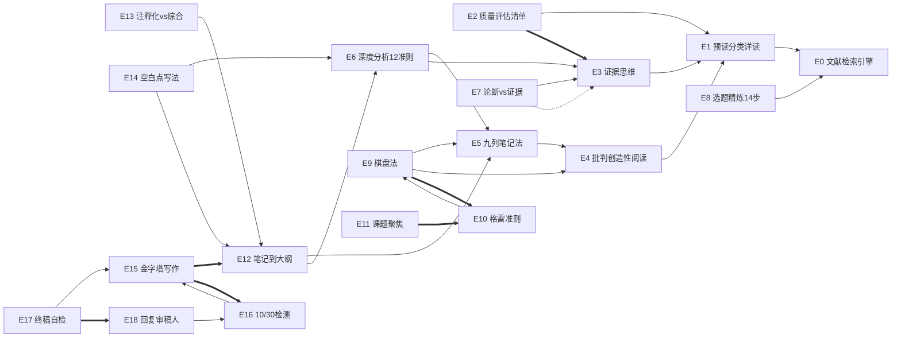

# 论文写作Skills 系列 · 体系总览 (SUITE_INDEX)

> 状态: **v0.9 草案 — 待 Rod 确认架构**
> 创建: 2026-08-13
> 定位: 本文件是整个系列体系的"宪法"。七工位流水线、skill 清单、统一依赖图、合并映射、目录约定都以本文件为准。Phase 2 理顺所有 skill 正文时逐条对照执行。

---

## 1. 系列定位

| 项 | 约定 |
|---|---|
| 系列名 | **论文写作Skills**（沿用第 0 期已发布物料） |
| 内容形式 | 每期一个 skill：抖音视频演示"给 AI 装一个 skill，一句话搞定一个科研环节"，skill 打包评论区自取 |
| 受众 | 研究生、科研新手、想用 AI 提效学术工作的人 |
| 源头 | 两本书蒸馏：《文献综述写作》(14 skill) + 《学术研究：你的成功之道》(9 skill)，原蒸馏归档在 `skill-library/books/`，不动 |
| 期号 | 按产线重排（0-18 主系列 + 可选加更），未发的两个已做视频对应第 4、9 期 |

---

## 2. 七工位流水线

```
检索(0) ──► 筛选(1-3) ──► 精读(4-7) ──► 方向发现(8-11) ──► 综述撰写(12-14) ──► 正文撰写(15-17) ──► 投稿返修(18)
   ▲                                                                                                    │
   └────────────────── 方向发现后回到检索/精读补充弹药（现实是循环，视频按线性讲）──────────────────────────┘
```


---

## 3. Skill 总清单

### 主系列（19 期）

| 期 | 工位 | skill id | 显示名 | 来源书 | 状态 |
|---|------|----------|--------|--------|------|
| 0 | 检索引擎 | `literature-search` | 文献检索引擎 | 自研（已安装） | ✅ 已发布 |
| 1 | 筛选 | `preread-classify-deepread` | 预读→分类→详读 | 文献综述 | 待做视频 |
| 2 | 筛选 | `research-quality-checklist` | 研究质量评估清单 | 文献综述（合并） | 待做视频 |
| 3 | 筛选 | `evidence-thinking` | 证据思维 | 文献综述（合并） | 待做视频 |
| 4 | 精读 | `critical-creative-paper-reading` | 批判性创造性阅读 | 成功之道 | 🎬 已做待发 |
| 5 | 精读 | `spreadsheet-note-system` | 九列笔记法 | 文献综述 | 待做视频 |
| 6 | 精读 | `deep-article-analysis` | 文献深度分析十二准则 | 文献综述 | 待做视频 |
| 7 | 精读 | `claim-vs-evidence` | 论断vs证据 | 文献综述 | 待做视频 |
| 8 | 方向 | `topic-refinement` | 选题精炼十四步 | 文献综述 | 待做视频 |
| 9 | 方向 | `matrix-method-topic-selection` | 棋盘法选题定位 | 成功之道 | 🎬 已做待发 |
| 10 | 方向 | `grays-criteria-problem-evaluation` | 格雷准则选题筛选 | 成功之道 | 待做视频 |
| 11 | 方向 | `research-focus-anti-guerrilla` | 课题聚焦反游击战 | 成功之道 | 待做视频 |
| 12 | 综述 | `notes-to-outline-synthesis` | 笔记→主题大纲 | 文献综述 | 待做视频 |
| 13 | 综述 | `annotative-vs-synthetic-writing` | 注释化vs综合叙述 | 文献综述 | 待做视频 |
| 14 | 综述 | `blank-spots-and-future-directions` | 空白点与未来方向 | 文献综述 | 待做视频 |
| 15 | 正文 | `top-down-pyramid-writing` | 金字塔写作法 | 成功之道 | 待做视频 |
| 16 | 正文 | `ten-thirty-readability-test` | 10/30 可读性检测 | 成功之道 | 待做视频 |
| 17 | 正文 | `final-self-edit-checklist` | 终稿自检 | 文献综述（合并） | 待做视频 |
| 18 | 返修 | `response-to-reviewers` | 回复审稿人 | **新做**（素材：成功之道 rebuttal 词条 + 15 反例） | 待做视频 |

### 可选加更（不占主系列期号）

| 期 | 工位 | skill id | 显示名 | 说明 |
|---|------|----------|--------|------|
| B1 | 方向 | `academic-brainstorming-ideation` | 学术头脑风暴 | 团队协作场景，视数据决定 |
| B2 | 正文 | `thesis-blueprint-planning` | 博士论文蓝图 | 博士二年级规划，受众较窄 |

### 不进本系列

| skill id | 原因 |
|----------|------|
| `progressive-improvement-writing-coaching` (PI指导法) | 受众是导师不是学生，保留在 books/ 归档 |

---

## 4. 合并映射（Phase 2 执行）

| 原 skill（books/ 归档） | 新 skill（suites/） | 合并逻辑 |
|---|---|---|
| `quantitative-quality-checklist` + `qualitative-quality-checklist` | `research-quality-checklist` | 一个 skill 内两条对照清单（定量 13 条 / 定性 8 条），删掉重复的评估流程骨架 |
| `all-research-is-flawed` + `juror-evidence-evaluation` | `evidence-thinking` | 前者是后者的认知前提（原 INDEX 已标 depends-on），合并为"认知前提 + 评估流程"一个整体 |
| `reader-is-always-right` + `final-self-edit-checklist` | `final-self-edit-checklist` | 心态原则作为 skill 的 R/I 段，100 项清单保留为主体 |

原 23 个 skill 中：6 个合并为 3 个、1 个不进系列、2 个可选 → 主系列 19 个（含新做 1 个）。

---

## 5. 统一依赖图（二合一，Phase 2 理顺正文的依据）

图例：`-->` depends-on（先学 A 才能用 B）；`==>` composes-with（常配合）；`-.->` contrasts-with（两种可选方案）



### 依赖关系文字版（写入各 skill 的"相关 skills"段）

| skill | depends-on | composes-with | contrasts-with |
|---|---|---|---|
| E1 预读分类 | E0 | — | — |
| E2 质量清单 | E1 | E3 | — |
| E3 证据思维 | E1 | E2 | E7 |
| E4 批判创造性阅读 | E1 | E9, E5 | — |
| E5 九列笔记 | E4 | E12 | — |
| E6 深度分析 | E5, E3 | E7, E12 | — |
| E7 论断vs证据 | E3 | E6 | E3 |
| E8 选题精炼 | E0 | E9 | — |
| E9 棋盘法 | E4, E5 | E10, E8 | — |
| E10 格雷准则 | E9 | E11 | — |
| E11 课题聚焦 | — | E10 | — |
| E12 笔记到大纲 | E5, E6 | E15 | — |
| E13 注释化vs综合 | E12 | — | — |
| E14 空白点写法 | E6, E12 | — | — |
| E15 金字塔写作 | — | E12, E16 | — |
| E16 10/30检测 | E15 | E15 | — |
| E17 终稿自检 | E15 | E18 | — |
| E18 回复审稿人 | E16 | E17 | — |

注：E7 与 E3 为"两种可选方案"关系——整体权衡用陪审员模型（E3），逐句拆解用论断vs证据（E7），视阅读目的选用。

---

## 6. 每期串场指针表（视频结尾预告下一工位）

| 期 | 结尾串场 |
|---|---------|
| 0 | "这是底座。下期用这个底座，教你让 AI 批量筛论文、自动提取核心观点"（已承诺，必须兑现） |
| 1 | "筛出一堆，哪篇值得信？下期给你 13+8 条质量清单，AI 逐篇打分" |
| 2 | "清单打分背后是什么？下期：证据思维——所有研究都有缺陷，像陪审员一样看论文" |
| 3 | "带着证据思维，正式进入精读工位。下期：30% 读、70% 想的批判性创造性阅读" |
| 4 | "读出来的想法别丢，下期九列笔记法，让 AI 把一篇论文榨成一张表格" |
| 5 | "笔记有了，怎么往深挖？下期：精读 12 准则，读出作者自己都没意识到的漏洞" |
| 6 | "深挖之后再给你一个显微镜技能。下期：论断vs证据，一句话认出论文里的推测" |
| 7 | "精读工位毕业。读了这么多，你的研究方向在哪？下期：选题精炼 14 步" |
| 8 | "选题缩小了，创新点在哪？下期：一张棋盘，定位你的研究空白" |
| 9 | "空格子不等于好课题。下期格雷准则：5 条标准筛出真正值得做的那个" |
| 10 | "课题定了，博士生最大的坑是精力分散。下期：反课题游击战" |
| 11 | "方向有了，开始写综述。下期：从九列笔记到主题大纲，先定论点再动笔" |
| 12 | "大纲有了，下期教你别写成伪综述：注释化 vs 综合叙述" |
| 13 | "综述怎么收尾才有分量？下期：空白点与未来方向的正确写法" |
| 14 | "综述搞定，正文怎么写？下期：论文就是逻辑论证，金字塔五步骨架" |
| 15 | "写完了先别投。下期：10/30 检测，投稿前最后一道可读性关口" |
| 16 | "改到能投了，投之前最后一关。下期：读者永远是对的——终稿 100 项自查" |
| 17 | "投出去了，审稿意见回来了怎么办？收官期：逐条回复审稿人，从拒稿到录用" |
| 18 | "整条产线到此闭环。评论区打包全部 19 个 skill，一句话装进你的 AI" |

---

## 7. 目录结构约定

```
C:\Users\16112\.config\opencode\skill-library\suites\paper-writing-skills\
├── SUITE_INDEX.md              # 本文件：体系宪法
├── EPISODE_PLAN.md             # 视频期数规划：每期钩子/内容要点/串场/状态
├── stage1-search\              # Phase 2 创建，每工位一个目录
│   └── literature-search\      # 每个 skill 一个子目录，SKILL.md 为入口
├── stage2-screen\              # 含合并后的新 skill
├── stage3-read\
├── stage4-direction\
├── stage5-review\
├── stage6-writing\
└── stage7-rebuttal\
```

约定：
- **命名**：目录用 stageN-xxx 英文；skill id 全部小写连字符；显示名中文
- **来源**：已合并/新做的 skill 只在 suites/ 存最终版；未合并的 skill 在 books/ 保留原蒸馏版，suites/ 放理顺后的拷贝
- **打包**：每期视频发布时，从对应 stage 目录打包该 skill 供粉丝下载
- **books/ 不动**：蒸馏审计档案，追溯"这个 skill 出自哪本书哪一章"永远查得到

---

## 8. Phase 2 理顺正文的约定（每个 skill 必改项）

架构确认后，逐 skill 执行以下修改：

1. **frontmatter**：`related_skills` 从 `[]` 填实为依赖表（第 5 节）中该 skill 的 depends-on / composes-with / contrasts-with 三项（skill id 列表）
2. **底部"相关 skills"段**：用统一模板重写，删除 `{{}}` 占位符
3. **A2"与相邻 skill 的区分"**：按统一依赖图重写，删除只在原书内有效的表述（如"参见棋盘法 v01"）
4. **新增"产线位置"行**：`> 产线位置：第X期 · XX工位 · 上游[E id] / 下游[E id]`
5. **不动**：
   - 3 个已做视频 skill 的方法论正文（E0/E4/E9 的 R/I/A1/E/B 段），仅补引用类字段
   - 所有 skill 的 R/I/E 蒸馏主体（那是书的精华）
   - books/ 目录整体

---

## 9. 溯源表（skill → 书 → 章节）

| suites/ 中的 skill | 原书 skill | 书 | 章节 |
|---|---|---|---|
| E0 | literature-search（自研） | — | — |
| E1 | preread-classify-deepread | 文献综述 | 第2-4章 |
| E2 | quantitative + qualitative-quality-checklist | 文献综述 | 第6-7章 |
| E3 | all-research-is-flawed + juror-evidence-evaluation | 文献综述 | 第5章 |
| E4 | critical-creative-paper-reading | 成功之道 | 第3章 3.3-3.4 |
| E5 | spreadsheet-note-system | 文献综述 | 第5章 |
| E6 | deep-article-analysis | 文献综述 | 第5章 |
| E7 | claim-vs-evidence | 文献综述 | 第5章 |
| E8 | topic-refinement | 文献综述 | 第3章 |
| E9 | matrix-method-topic-selection | 成功之道 | 第4章 4.3/4.5 |
| E10 | grays-criteria-problem-evaluation | 成功之道 | 第4章 |
| E11 | research-focus-anti-guerrilla | 成功之道 | 第2章 |
| E12 | notes-to-outline-synthesis | 文献综述 | 第9章 |
| E13 | annotative-vs-synthetic-writing | 文献综述 | 第11章 |
| E14 | blank-spots-and-future-directions | 文献综述 | 第10章 |
| E15 | top-down-pyramid-writing | 成功之道 | 第5章 |
| E16 | ten-thirty-readability-test | 成功之道 | 第5章 |
| E17 | reader-is-always-right + final-self-edit-checklist | 文献综述 | 第12-13章+附录A |
| E18 | **新做** | 成功之道（rebuttal 词条 + ce01-ce15 反例）+ 通用惯例 | 第6章 6.7 |
